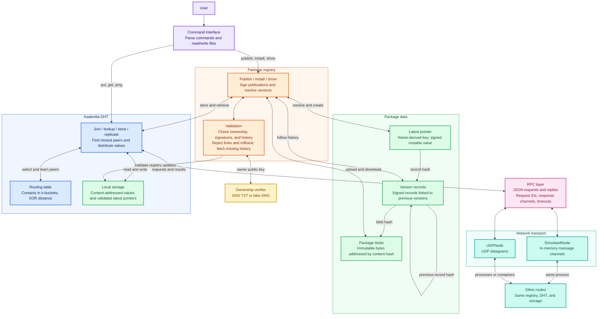

# System architecture

Read the main path from top to bottom: commands enter the registry or DHT, the DHT uses RPC, and the transport connects peer nodes. Each component shows one level of detail. Colors identify responsibilities: purple for the interface, orange for the registry, yellow for ownership verification, green for data, blue for the DHT, pink for RPC, and teal for networking.

Publishing stores the blob and signed version record, then advances the latest pointer after validation. Installing follows the pointer and version chain to retrieve a verified blob. The DHT locates replicas, RPC matches requests with replies, and the selected transport carries messages between nodes.
