# System architecture: triggers and connections

This view connects the implemented Part 1 system to the planned Part 2 package registry. **Blue blocks exist in the Go code. Orange dashed blocks are future functionality.** Arrows describe calls, messages, state changes, or data references; arrow labels identify the trigger. Every peer runs the same DHT and RPC logic.

## Whole system

```mermaid
flowchart TB
    USER["User / package publisher"]

    subgraph ENTRY["Entry points"]
        CLI["Cobra CLI / interactive shell<br/>cmd/simshell/main.go"]:::current
        BOOT["Startup: configure address and transport<br/>Create node ID, routing table, and data store<br/>Start ListenForRPC"]:::current
        JOIN["Bootstrap available: Join<br/>Look up own ID and refresh distance ranges"]:::current
        EXP["Experiment runner / tests<br/>Create nodes and trigger stores and lookups<br/>Measure latency, probes, loss, and churn"]:::current
    end

    subgraph LOCAL["Implemented Part 1: each node"]
        PUT["put FILE / Store<br/>Read bytes; enforce 1-32768 bytes<br/>Compute SHA-256 key"]:::current
        GET["get KEY / LookupData<br/>Check local data, otherwise FIND_VALUE<br/>Verify returned size and hash"]:::current
        LOOKUP["LookupContact<br/>Select peers by XOR distance<br/>Probe up to Alpha peers per round<br/>Learn closer contacts from replies"]:::current
        ROUTE["RoutingTable -> buckets -> contacts<br/>256-bit IDs; linked-list contact order<br/>Mutex protects shared routing state"]:::current
        REPLICAS["Store placement<br/>Discover up to K closest replicas<br/>Store locally if selected; send STORE to peers"]:::current
        DATA["Local DataStore<br/>SHA-256(value) -> value bytes<br/>RWMutex protects shared data"]:::current
        SEND["Outgoing JSON RPC<br/>FIND_NODE / FIND_VALUE / STORE<br/>Register random request ID and response channel<br/>Send request, then wait"]:::current
        WAIT["Reply or timeout<br/>Match request ID and signal channel<br/>Remove pending request<br/>Return result/error; lookup may try other peers"]:::current
        RECEIVE["ListenForRPC -> handler goroutine<br/>Decode JSON and dispatch by message type"]:::current
        HANDLE["Request handlers<br/>FIND_NODE: nearest contacts<br/>FIND_VALUE: value or nearest contacts<br/>STORE: validate size and content hash"]:::current
        REPLY["JSON reply<br/>Echo request ID and include result"]:::current
        TRANSPORT["Node interface: Listen / SendData / Receive / Close<br/>SimulatedNode: shared in-memory channels<br/>UDPNode: actual UDP sockets"]:::current
        MAINT["ReplicateData / optional StartReplication timer<br/>Snapshot local values and call Store again"]:::current
        OUTPUT["CLI output<br/>Print hash, value, state, or error<br/>Write downloaded bytes to file"]:::current
    end

    PEERS["Other nodes<br/>Same request handlers and local state<br/>Same process in simulation<br/>Separate processes / Docker containers over UDP"]:::current

    USER -->|command| CLI
    CLI -->|configure| BOOT
    BOOT -->|bind or register address| TRANSPORT
    BOOT -->|initialize| ROUTE
    BOOT -->|initialize| DATA
    BOOT -->|start receive loop| RECEIVE
    BOOT -->|bootstrap configured| JOIN
    JOIN --> LOOKUP
    CLI -->|put / store| PUT
    CLI -->|get| GET
    CLI -->|ping uses node lookup| LOOKUP
    CLI -->|show rt| ROUTE
    CLI -->|show ds| DATA
    CLI -->|show nodes / serve / test| OUTPUT
    EXP --> PUT
    EXP --> GET
    EXP --> LOOKUP
    PUT --> REPLICAS
    REPLICAS --> LOOKUP
    REPLICAS -->|selected local replica| DATA
    REPLICAS -->|remote replica| SEND
    GET -->|local read| DATA
    GET -->|local miss| SEND
    GET -->|choose candidates| ROUTE
    LOOKUP <--> ROUTE
    LOOKUP --> SEND
    SEND -->|encoded bytes| TRANSPORT
    TRANSPORT <-->|requests and replies| PEERS
    TRANSPORT -->|incoming payload| RECEIVE
    RECEIVE -->|request| HANDLE
    RECEIVE -->|reply| WAIT
    HANDLE -->|read contacts / learn sender| ROUTE
    HANDLE -->|read value / accept valid STORE| DATA
    HANDLE --> REPLY
    REPLY --> TRANSPORT
    WAIT -->|result / newly learned contacts| LOOKUP
    WAIT -->|value or next candidates| GET
    WAIT -->|STORE acknowledgement| REPLICAS
    SEND -->|deadline expires| WAIT
    MAINT --> PUT
    DATA -->|snapshot| MAINT
    REPLICAS -->|at least one accepted replica / error| OUTPUT
    GET -->|verified bytes / error| OUTPUT
    OUTPUT --> USER

    subgraph FUTURE["Planned Part 2: signed package registry on each node"]
        COMMANDS["publish --force --prev DOMAIN:PACKAGE:VERSION FILE<br/>install DOMAIN:PACKAGE:VERSION or latest<br/>show DOMAIN:PACKAGE / show dns DOMAIN<br/>show ds: interpret records and latest pointers"]:::future
        PUBLISH["Publish preflight<br/>Resolve current head and previous record<br/>Require newer version and correct predecessor<br/>--force skips these local checks only"]:::future
        SIGN["Publisher's private key<br/>Sign version record and latest pointer<br/>Signature covers hash of all unsigned fields"]:::future
        OWNER["Ownership verifier interface<br/>Real DNS TXT or fake DNS<br/>Resolve domain owner's public key"]:::future
        VALIDATE["Receiving-node validation gate<br/>Check key, tag, domain, package, and signature<br/>Check pointer agrees with referenced record<br/>Require chain to extend accepted local head<br/>Reject forks, cycles, and rollback"]:::future
        CATCHUP["Missing history detected<br/>Fetch and verify missing predecessor records<br/>Connect candidate head to accepted local head<br/>Advance only after successful validation"]:::future
        MUTABLE["DHT/RPC storage and lookup extension<br/>Handle signed mutable latest pointers<br/>Enforce validation before accepting updates"]:::future
        HEAD["Latest pointer<br/>Key = SHA-256(domain:package:latest)<br/>Signed value: domain, package, version, record hash"]:::future
        RECORD["Immutable signed version record<br/>Key = SHA-256(entire signed record)<br/>Domain, package, version, blob hash, previous hash"]:::future
        PREVIOUS["Previous version record -> older records<br/>First record uses all-zero previous hash<br/>Versions strictly increase toward the head"]:::future
        BLOB["Immutable package bytes<br/>Key = SHA-256(blob)"]:::future
        INSTALL["Install / show package<br/>Resolve latest pointer; verify chain and signatures<br/>Follow predecessors to requested version<br/>Fetch blob and verify hash; save installed file"]:::future
    end

    CLI -.->|new commands| COMMANDS
    COMMANDS -->|publish| PUBLISH
    PUBLISH -->|read accepted latest| MUTABLE
    PUBLISH --> SIGN
    SIGN -->|content-addressed upload| RECORD
    PUBLISH -->|file bytes| BLOB
    SIGN -->|attempt latest update| MUTABLE
    MUTABLE -.->|future RPC integration| SEND
    HANDLE -.->|future registry writes| VALIDATE
    VALIDATE <--> OWNER
    COMMANDS -->|show dns| OWNER
    VALIDATE -->|unknown predecessor| CATCHUP
    CATCHUP -->|content-addressed lookups| GET
    CATCHUP -->|verified ancestry| VALIDATE
    VALIDATE -->|accept latest update| HEAD
    MUTABLE -->|read accepted latest| HEAD
    RECORD -->|existing Store path| PUT
    BLOB -->|existing Store path| PUT
    HEAD -->|versionRecordHash| RECORD
    RECORD -->|previous-version-record| PREVIOUS
    RECORD -->|blobHash| BLOB
    COMMANDS -->|install / show package| INSTALL
    INSTALL -->|name-based latest lookup| MUTABLE
    INSTALL -->|records and blob by hash| GET
    INSTALL <--> OWNER
    INSTALL --> OUTPUT
    HEAD -.->|future structured state display| OUTPUT
    RECORD -.->|future structured state display| OUTPUT

    classDef current fill:#dbeafe,stroke:#2563eb,color:#172554,stroke-width:2px
    classDef future fill:#ffedd5,stroke:#ea580c,color:#7c2d12,stroke-width:2px,stroke-dasharray:5 5
```

## Critical triggers

| Trigger | What happens next |
| --- | --- |
| Node starts | Create its state, select simulated or UDP transport, listen for RPCs, and join through a bootstrap contact when configured. |
| `put FILE` | Validate size, hash bytes, discover close replicas, and collect STORE acknowledgements. At least one replica must accept for Store to succeed. |
| `get KEY` | Verify local data or query peers; follow returned contacts until verified data is found or candidates are exhausted. |
| `ping ADDRESS` | The shell hashes the address and performs a contact lookup; this CLI path uses FIND_NODE rather than a separate PING RPC. |
| RPC request arrives | Decode JSON, run the appropriate handler, access protected local state, and send a reply containing the original request ID. |
| RPC reply arrives / deadline expires | Complete the pending response channel or return a timeout; clean up the request entry. Default RPC timeout: two seconds. |
| Replication invoked | Snapshot stored values and redistribute through Store. A timer implementation exists, but the current shell does not start it automatically. |
| Future `publish` | Sign the immutable version record and mutable latest pointer. Receiving nodes independently enforce ownership and history rules. |
| Future newer head has missing ancestors | Retrieve and verify the missing chain before accepting the head; a higher version alone is insufficient. |
| Future `install` / package `show` | Resolve the signed latest pointer, traverse verified version records, and retrieve the selected content-addressed blob. |

## Implementation boundaries

The existing data store is an in-memory map. UDP transports run across processes or containers; simulated transports connect nodes through a shared in-process network. Docker changes deployment, not the DHT protocol. Experiments and tutorials are separate entry points/examples, not required services in the running registry. Tests check routing, networking, lookup/storage behavior, CLI behavior, value limits, and experiment results.

Part 1 uses SHA-256 content addressing and accepts arbitrary bytes within its size limit; it does not establish package ownership. Its STORE and lookup hash checks must be extended explicitly for the name-derived latest-pointer key. Immutable package blobs and version records continue to use content hashes. Registry validation must also protect replicated latest updates and verify pointers read from peers.

Part 2 is a plan, not implemented code. Signature algorithm, canonical signed encoding, DNS TXT public-key encoding, and total version order still need documented choices. Rejecting a conflicting branch against a node's accepted history provides local enforcement; guaranteeing one global head during concurrent publications or network partitions requires an explicit coordination/conflict policy. Larger package binaries also need a chunking or size policy because the current Store limit is 32 KiB per value. In-memory replication alone does not guarantee permanent availability of older versions.

Source map: [shell](cmd/simshell/main.go), [DHT and RPC](kademlia/kademlia.go), [transports](kademlia/network.go), [routing table](kademlia/routingtable.go), [buckets](kademlia/bucket.go), [contacts](kademlia/contact.go), [identifiers](kademlia/kademliaid.go), [experiments](experiments/README.md), [Docker deployment](docker-compose.yml), [Part 2 design](PART2-DESIGN.md), and [detailed Part 1 diagrams](ARCHITECTURE.md).
