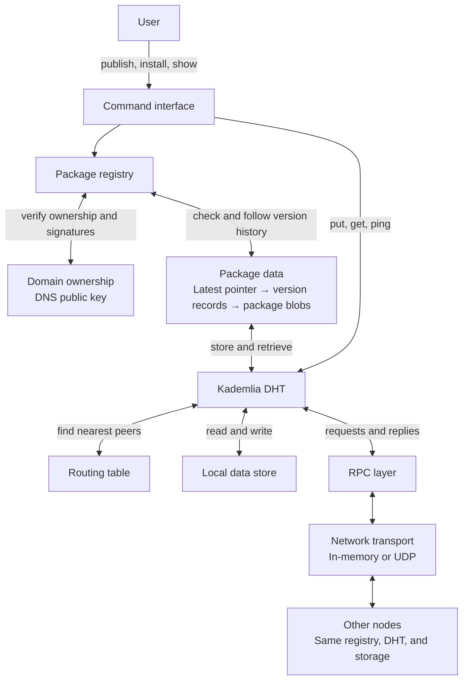

# System architecture

The command interface connects users to the package registry. The registry verifies ownership and version history, while the DHT stores and retrieves data across peer nodes.

Publishing stores the package blob and signed version record, then updates the latest pointer after ownership and history checks. Installing follows the pointer and version records to download the package blob. The DHT finds the peers holding the data; RPC and the network transport carry the requests and replies.
