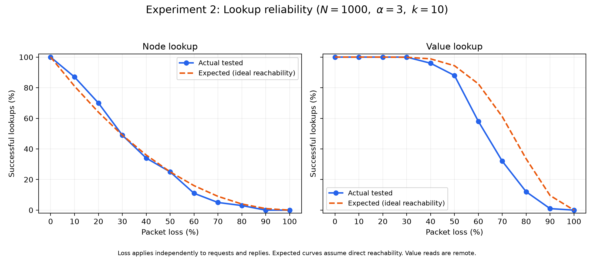

# Experiment 2: Lookup reliability as a function of packet loss

## Experimental setup

N=1000; alpha=3; k=10; seeds=1,2,3,4,5; 20 trials per seed/type/loss; loss levels=[0 0.1 0.2 0.3 0.4 0.5 0.6 0.7 0.8 0.9 1]; RPC timeout=50ms. No latency, churn, retries or background repair.

Each configuration/loss/seed starts a fresh populated bounded network with unique seeded random IP:port addresses, SHA-256(IP|port) IDs, independently shuffled peer insertion and the implementation's 20-contact buckets. Topologies and randomly generated value/source/target workloads are matched across loss levels. Actual Store runs without loss first; the replica count is checked against min(k,N). Sources are chosen outside the replica set, excluding local value hits. Routing learning remains enabled between trials; node trials precede value trials. This tests lookup loss tolerance, not publishing under loss or joining.

Packet dropping wraps every node's transport, covering both requests and replies. Independent seeded pseudorandom draws for each trial/type/source/destination/direction apply loss p to each packet. Stable SHA-256 draws exclude crypto-random RPC IDs and do not depend on send ordering; the same draw is reused across loss levels for matched nested masks. Replies retain their originating trial's mask even if late. The algorithm's scheduling and learned routing state can still affect which contacts are queried.

## Measurements and correctness

Node success means the target contact was returned AND a FIND_NODE response from that exact target arrived. Returning a cached contact after its probe times out is reported separately and cannot count as confirmed success. Value success requires a remote LookupData result exactly equal to the original generated bytes. Each launched request is counted at the transport; real batch callbacks count rounds. Packet CSV rows identify request drops, reply attempts/drops and received responses. Early successful values still account for every launched probe. A reply that arrives after completion can remain absent in the completion snapshot. Trial duration includes the final accounting wait and timeout costs.

Means and unbiased sample variances are reported for binary success, probes, rounds and elapsed time. Independent-seed success-rate variance and its standard error describe between-topology variability; trials sharing a seed are not treated as independent networks. Packet logs can reconcile the measured probe totals and distinguish request loss from reply loss.

## Expected behavior

For independent per-packet loss p, one request/reply exchange succeeds with q=(1-p)^2. The node reference is q: it assumes the target can be reached directly and is queried once. The value reference is 1-(1-q)^r for r verified replicas: it assumes all r can be queried without extra routing failures. These are ideal-reachability references, not exact predictions for multi-step lookup. They isolate the expected benefit of replication. Healthy remote lookups should succeed; complete packet loss should make both confirmed node and remote value lookups fail.

Actual reliability can fall below the reference because lost intermediate replies prevent discovering the target or replicas, fewer replicas are queried, timed-out contacts remain in the shortlist, or a response misses the timeout. Finite-sample rates can lie above an expectation. Higher loss should generally reduce reliability and increase timeout costs; individual measured points need not be monotonic. Alpha provides parallel opportunities, whereas k provides replica redundancy. The Kademlia protocol's parallel node search, value replication and early value termination motivate this distinction: [original paper, section 2.2](https://pdos.csail.mit.edu/~petar/papers/maymounkov-kademlia.pdf).

## Observed results

| N | alpha | k | loss | type | samples | success mean | success variance | seed-rate variance | expected | mean probes | probe variance | mean rounds | round variance |
|---:|---:|---:|---:|---|---:|---:|---:|---:|---:|---:|---:|---:|---:|
| 1000 | 3 | 10 | 0.00 | node | 100 | 1.0000 | 0.0000 | 0.0000 | 1.0000 | 12.0600 | 1.1883 | 4.4800 | 0.2521 |
| 1000 | 3 | 10 | 0.00 | value | 100 | 1.0000 | 0.0000 | 0.0000 | 1.0000 | 4.3800 | 2.2582 | 1.4600 | 0.2509 |
| 1000 | 3 | 10 | 0.10 | node | 100 | 0.8700 | 0.1142 | 0.0007 | 0.8100 | 12.0900 | 1.2544 | 4.4900 | 0.2524 |
| 1000 | 3 | 10 | 0.10 | value | 100 | 1.0000 | 0.0000 | 0.0000 | 1.0000 | 4.5000 | 2.2727 | 1.5000 | 0.2525 |
| 1000 | 3 | 10 | 0.20 | node | 100 | 0.7000 | 0.2121 | 0.0037 | 0.6400 | 12.3800 | 2.3592 | 4.5600 | 0.3297 |
| 1000 | 3 | 10 | 0.20 | value | 100 | 1.0000 | 0.0000 | 0.0000 | 1.0000 | 4.7400 | 2.7600 | 1.5800 | 0.3067 |
| 1000 | 3 | 10 | 0.30 | node | 100 | 0.4900 | 0.2524 | 0.0067 | 0.4900 | 12.7100 | 3.8443 | 4.6700 | 0.5062 |
| 1000 | 3 | 10 | 0.30 | value | 100 | 1.0000 | 0.0000 | 0.0000 | 0.9988 | 5.7000 | 6.4545 | 1.9000 | 0.7172 |
| 1000 | 3 | 10 | 0.40 | node | 100 | 0.3400 | 0.2267 | 0.0042 | 0.3600 | 13.0300 | 5.7062 | 4.7700 | 0.7041 |
| 1000 | 3 | 10 | 0.40 | value | 100 | 0.9600 | 0.0388 | 0.0005 | 0.9885 | 7.0100 | 13.9494 | 2.3700 | 1.7102 |
| 1000 | 3 | 10 | 0.50 | node | 100 | 0.2500 | 0.1894 | 0.0088 | 0.2500 | 13.5300 | 8.3324 | 4.9100 | 0.9514 |
| 1000 | 3 | 10 | 0.50 | value | 100 | 0.8800 | 0.1067 | 0.0032 | 0.9437 | 8.2000 | 18.5859 | 2.8100 | 2.3373 |
| 1000 | 3 | 10 | 0.60 | node | 100 | 0.1100 | 0.0989 | 0.0018 | 0.1600 | 13.4900 | 12.1312 | 4.9400 | 1.2893 |
| 1000 | 3 | 10 | 0.60 | value | 100 | 0.5800 | 0.2461 | 0.0095 | 0.8251 | 10.6500 | 25.3005 | 3.8400 | 3.5095 |
| 1000 | 3 | 10 | 0.70 | node | 100 | 0.0500 | 0.0480 | 0.0013 | 0.0900 | 13.1000 | 14.0707 | 4.8500 | 1.2803 |
| 1000 | 3 | 10 | 0.70 | value | 100 | 0.3200 | 0.2198 | 0.0082 | 0.6106 | 11.5500 | 18.6742 | 4.2800 | 2.3855 |
| 1000 | 3 | 10 | 0.80 | node | 100 | 0.0300 | 0.0294 | 0.0008 | 0.0400 | 11.5300 | 7.6658 | 4.4300 | 0.7122 |
| 1000 | 3 | 10 | 0.80 | value | 100 | 0.1200 | 0.1067 | 0.0033 | 0.3352 | 11.3600 | 14.5964 | 4.3300 | 1.7587 |
| 1000 | 3 | 10 | 0.90 | node | 100 | 0.0000 | 0.0000 | 0.0000 | 0.0100 | 10.3900 | 2.5029 | 4.1000 | 0.2121 |
| 1000 | 3 | 10 | 0.90 | value | 100 | 0.0100 | 0.0100 | 0.0005 | 0.0956 | 10.3100 | 4.7211 | 4.1000 | 0.5960 |
| 1000 | 3 | 10 | 1.00 | node | 100 | 0.0000 | 0.0000 | 0.0000 | 0.0000 | 10.0000 | 0.0000 | 4.0000 | 0.0000 |
| 1000 | 3 | 10 | 1.00 | value | 100 | 0.0000 | 0.0000 | 0.0000 | 0.0000 | 10.0000 | 0.0000 | 4.0000 | 0.0000 |

## Comparison and deviations

- N=1000, alpha=3, k=10, node at loss=0.0000: actual 100.0%, ideal reference 100.0% (gap 0.0 percentage points).
- N=1000, alpha=3, k=10, value at loss=0.0000: actual 100.0%, ideal reference 100.0% (gap 0.0 percentage points).
- N=1000, alpha=3, k=10, node at loss=0.5000: actual 25.0%, ideal reference 25.0% (gap 0.0 percentage points).
- N=1000, alpha=3, k=10, value at loss=0.5000: actual 88.0%, ideal reference 94.4% (gap -6.4 percentage points).
- N=1000, alpha=3, k=10, node at loss=1.0000: actual 0.0%, ideal reference 0.0% (gap 0.0 percentage points).
- N=1000, alpha=3, k=10, value at loss=1.0000: actual 0.0%, ideal reference 0.0% (gap 0.0 percentage points).

Use packets.csv to inspect failed target confirmation and the number of received responses. Low value reliability relative to the ideal replica reference can reflect routing/shortlist limitations as well as finite-sample variation. This experiment deliberately uses the existing algorithm, including its timeout and failed-contact handling. It does not change the algorithm to match the reference.

