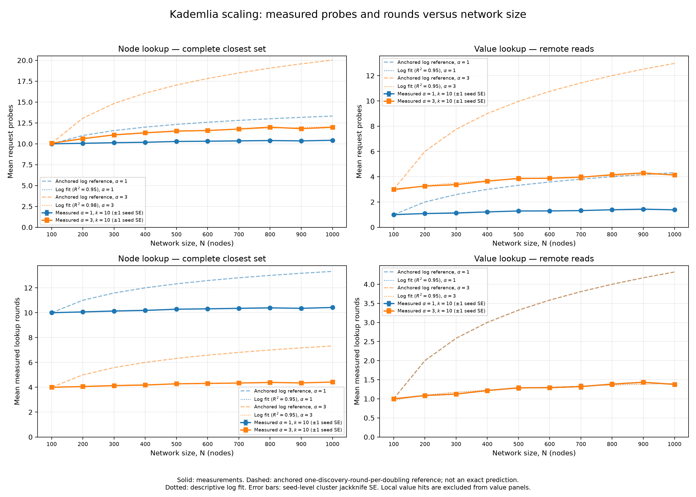

# Kademlia lookup scaling experiment

## Setup

Network sizes: 100,200,300,400,500,600,700,800,900,1000. Alpha: 1,3. Replication/shortlist k: 10. Seeds: 1,2,3,4,5. 20 trials per seed and lookup type; 32-byte random values.

Each configuration/seed gets a fresh lossless in-process network. Unique seeded random IP:port addresses produce SHA-256 IDs from IP|port, matching the simulator shell. Each routing table receives an independently shuffled peer list, subject to the implementation's 20-contact bucket limit and splitting rules. This models a populated healthy overlay, not network joining. It is not an unrestricted complete routing graph.

Separate seeded RNG streams generate workloads: random values with content-addressed SHA-256 keys, publishers, sources, and random target IDs. The same seed/N reuses the same addresses, insertion order and workload across alpha/k. Values are stored through the real Store method before measurements; all node trials precede value trials. Routing learning from publishing and earlier trials remains enabled. Seeds reproduce inputs, not goroutine scheduling or timestamps.

## Measurements and correctness

A probe is one outgoing FIND_NODE/FIND_VALUE request counted at SendData, filtered by source, type, target and selected destination. Replies and publishing traffic are excluded. A read-only batch observer records actual rounds and selected destinations before RPC goroutines start; it does not change routing decisions. Accounting waits for every launched request to reach the transport, including sends that follow an early successful value return. Measured rounds are sequential batches, not IP packet hops or an inferred ceil(probes/alpha).

Node success requires the complete ordered k-closest result to match an independent global XOR-distance sort, excluding the initiating node as the implementation does. Value success requires exact equality with the original stored bytes. Local reads are identified and remote value results are also reported separately. Raw result/probe rows permit reconciliation of batch sizes and probe counts.

Sample variances use denominator m-1 across lookup trials. Seed-mean variances describe variation between independently generated networks; plot standard errors use a leave-one-seed-out cluster jackknife, avoiding treating all trials in one network as independent networks and accounting for unequal remote sample counts.

## Expected behavior and comparison

The original Kademlia analysis and Cai–Devroye predict logarithmic routing growth under healthy bucket coverage/random-ID assumptions. Node lookup must discover and verify the closest set; this implementation keeps alpha-sized batches throughout completion, adding a baseline near k probes. Successful value lookup stops at the first replica, so generally needs fewer probes/rounds. Larger alpha may increase probes while reducing rounds. Local replicas yield zero probes and are separated from remote reads.

The plot overlays an empirical logarithmic-shape reference P(N)=P(N_min)+alpha*log2(N/N_min) and R(N)=R(N_min)+log2(N/N_min), one additional discovery batch per doubling. These are deliberately labelled anchored references, not exact theoretical predictions or proven bounds: bucket capacity, multiple contacts per reply, populated tables, termination, and asynchronous scheduling affect the coefficient and intercept. The plot also fits a+b*log2(N) descriptively; agreement over this finite range is not proof of asymptotic complexity.

Sources: [Maymounkov–Mazières, §§2.2–3](https://pdos.csail.mit.edu/~petar/papers/maymounkov-kademlia.pdf); [Cai–Devroye, random-ID analysis](https://arxiv.org/abs/1402.1191).

## Observed averages and variance

| config | type | scope | trials | seeds | success | probes mean | probes variance | rounds mean | rounds variance | seed-mean probe variance |
|---|---|---|---:|---:|---:|---:|---:|---:|---:|---:|
| n100-a1-k10 | node | all | 100 | 5 | 1.0000 | 10.0000 | 0.0000 | 10.0000 | 0.0000 | 0.0000 |
| n100-a1-k10 | value | all | 100 | 5 | 1.0000 | 0.8900 | 0.0989 | 0.8900 | 0.0989 | 0.0017 |
| n100-a1-k10 | value | remote | 89 | 5 | 1.0000 | 1.0000 | 0.0000 | 1.0000 | 0.0000 | 0.0000 |
| n100-a3-k10 | node | all | 100 | 5 | 1.0000 | 10.0700 | 0.0658 | 4.0000 | 0.0000 | 0.0070 |
| n100-a3-k10 | value | all | 100 | 5 | 1.0000 | 2.6700 | 0.8900 | 0.8900 | 0.0989 | 0.0158 |
| n100-a3-k10 | value | remote | 89 | 5 | 1.0000 | 3.0000 | 0.0000 | 1.0000 | 0.0000 | 0.0000 |
| n200-a1-k10 | node | all | 100 | 5 | 1.0000 | 10.0600 | 0.0570 | 10.0600 | 0.0570 | 0.0043 |
| n200-a1-k10 | value | all | 100 | 5 | 1.0000 | 1.0100 | 0.1514 | 1.0100 | 0.1514 | 0.0043 |
| n200-a1-k10 | value | remote | 93 | 5 | 1.0000 | 1.0860 | 0.0795 | 1.0860 | 0.0795 | 0.0024 |
| n200-a3-k10 | node | all | 100 | 5 | 1.0000 | 10.6100 | 0.8464 | 4.0600 | 0.0570 | 0.0230 |
| n200-a3-k10 | value | all | 100 | 5 | 1.0000 | 3.0300 | 1.3627 | 1.0100 | 0.1514 | 0.0382 |
| n200-a3-k10 | value | remote | 93 | 5 | 1.0000 | 3.2581 | 0.7153 | 1.0860 | 0.0795 | 0.0216 |
| n300-a1-k10 | node | all | 100 | 5 | 1.0000 | 10.1300 | 0.1142 | 10.1300 | 0.1142 | 0.0057 |
| n300-a1-k10 | value | all | 100 | 5 | 1.0000 | 1.0800 | 0.1552 | 1.0800 | 0.1552 | 0.0095 |
| n300-a1-k10 | value | remote | 96 | 5 | 1.0000 | 1.1250 | 0.1105 | 1.1250 | 0.1105 | 0.0055 |
| n300-a3-k10 | node | all | 100 | 5 | 1.0000 | 11.0700 | 1.2577 | 4.1300 | 0.1142 | 0.0932 |
| n300-a3-k10 | value | all | 100 | 5 | 1.0000 | 3.2400 | 1.3964 | 1.0800 | 0.1552 | 0.0855 |
| n300-a3-k10 | value | remote | 96 | 5 | 1.0000 | 3.3750 | 0.9947 | 1.1250 | 0.1105 | 0.0495 |
| n400-a1-k10 | node | all | 100 | 5 | 1.0000 | 10.1800 | 0.1491 | 10.1800 | 0.1491 | 0.0070 |
| n400-a1-k10 | value | all | 100 | 5 | 1.0000 | 1.1800 | 0.2097 | 1.1800 | 0.2097 | 0.0058 |
| n400-a1-k10 | value | remote | 97 | 5 | 1.0000 | 1.2165 | 0.1714 | 1.2165 | 0.1714 | 0.0057 |
| n400-a3-k10 | node | all | 100 | 5 | 1.0000 | 11.3200 | 1.2905 | 4.1800 | 0.1491 | 0.0333 |
| n400-a3-k10 | value | all | 100 | 5 | 1.0000 | 3.5400 | 1.8873 | 1.1800 | 0.2097 | 0.0517 |
| n400-a3-k10 | value | remote | 97 | 5 | 1.0000 | 3.6495 | 1.5425 | 1.2165 | 0.1714 | 0.0513 |
| n500-a1-k10 | node | all | 100 | 5 | 1.0000 | 10.2800 | 0.2036 | 10.2800 | 0.2036 | 0.0233 |
| n500-a1-k10 | value | all | 100 | 5 | 1.0000 | 1.2500 | 0.2500 | 1.2500 | 0.2500 | 0.0100 |
| n500-a1-k10 | value | remote | 97 | 5 | 1.0000 | 1.2887 | 0.2075 | 1.2887 | 0.2075 | 0.0171 |
| n500-a3-k10 | node | all | 100 | 5 | 1.0000 | 11.5300 | 1.4031 | 4.2800 | 0.2036 | 0.1870 |
| n500-a3-k10 | value | all | 100 | 5 | 1.0000 | 3.7500 | 2.2500 | 1.2500 | 0.2500 | 0.0900 |
| n500-a3-k10 | value | remote | 97 | 5 | 1.0000 | 3.8660 | 1.8673 | 1.2887 | 0.2075 | 0.1537 |
| n600-a1-k10 | node | all | 100 | 5 | 1.0000 | 10.3100 | 0.2161 | 10.3100 | 0.2161 | 0.0293 |
| n600-a1-k10 | value | all | 100 | 5 | 1.0000 | 1.2800 | 0.2238 | 1.2800 | 0.2238 | 0.0158 |
| n600-a1-k10 | value | remote | 99 | 5 | 1.0000 | 1.2929 | 0.2092 | 1.2929 | 0.2092 | 0.0140 |
| n600-a3-k10 | node | all | 100 | 5 | 1.0000 | 11.5900 | 1.4161 | 4.3100 | 0.2161 | 0.1242 |
| n600-a3-k10 | value | all | 100 | 5 | 1.0000 | 3.8400 | 2.0145 | 1.2800 | 0.2238 | 0.1418 |
| n600-a3-k10 | value | remote | 99 | 5 | 1.0000 | 3.8788 | 1.8831 | 1.2929 | 0.2092 | 0.1262 |
| n700-a1-k10 | node | all | 100 | 5 | 1.0000 | 10.3500 | 0.2500 | 10.3500 | 0.2500 | 0.0062 |
| n700-a1-k10 | value | all | 100 | 5 | 1.0000 | 1.2800 | 0.2642 | 1.2800 | 0.2642 | 0.0270 |
| n700-a1-k10 | value | remote | 97 | 5 | 1.0000 | 1.3196 | 0.2197 | 1.3196 | 0.2197 | 0.0234 |
| n700-a3-k10 | node | all | 100 | 5 | 1.0000 | 11.7700 | 1.2900 | 4.3400 | 0.2267 | 0.0108 |
| n700-a3-k10 | value | all | 100 | 5 | 1.0000 | 3.8400 | 2.3782 | 1.2800 | 0.2642 | 0.2430 |
| n700-a3-k10 | value | remote | 97 | 5 | 1.0000 | 3.9588 | 1.9774 | 1.3196 | 0.2197 | 0.2107 |
| n800-a1-k10 | node | all | 100 | 5 | 1.0000 | 10.3900 | 0.2403 | 10.3900 | 0.2403 | 0.0218 |
| n800-a1-k10 | value | all | 100 | 5 | 1.0000 | 1.3300 | 0.3041 | 1.3300 | 0.3041 | 0.0057 |
| n800-a1-k10 | value | remote | 96 | 5 | 1.0000 | 1.3854 | 0.2394 | 1.3854 | 0.2394 | 0.0168 |
| n800-a3-k10 | node | all | 100 | 5 | 1.0000 | 12.0000 | 1.0303 | 4.3900 | 0.2403 | 0.0463 |
| n800-a3-k10 | value | all | 100 | 5 | 1.0000 | 3.9900 | 2.7373 | 1.3300 | 0.3041 | 0.0517 |
| n800-a3-k10 | value | remote | 96 | 5 | 1.0000 | 4.1562 | 2.1543 | 1.3854 | 0.2394 | 0.1508 |
| n900-a1-k10 | node | all | 100 | 5 | 1.0000 | 10.3500 | 0.2298 | 10.3500 | 0.2298 | 0.0663 |
| n900-a1-k10 | value | all | 100 | 5 | 1.0000 | 1.3900 | 0.3009 | 1.3900 | 0.3009 | 0.0043 |
| n900-a1-k10 | value | remote | 97 | 5 | 1.0000 | 1.4330 | 0.2481 | 1.4330 | 0.2481 | 0.0015 |
| n900-a3-k10 | node | all | 100 | 5 | 1.0000 | 11.8100 | 1.2868 | 4.3500 | 0.2298 | 0.2355 |
| n900-a3-k10 | value | all | 100 | 5 | 1.0000 | 4.1700 | 2.7082 | 1.3900 | 0.3009 | 0.0383 |
| n900-a3-k10 | value | remote | 97 | 5 | 1.0000 | 4.2990 | 2.2326 | 1.4330 | 0.2481 | 0.0135 |
| n1000-a1-k10 | node | all | 100 | 5 | 1.0000 | 10.4200 | 0.2461 | 10.4200 | 0.2461 | 0.0133 |
| n1000-a1-k10 | value | all | 100 | 5 | 1.0000 | 1.3500 | 0.2702 | 1.3500 | 0.2702 | 0.0050 |
| n1000-a1-k10 | value | remote | 98 | 5 | 1.0000 | 1.3776 | 0.2374 | 1.3776 | 0.2374 | 0.0065 |
| n1000-a3-k10 | node | all | 100 | 5 | 1.0000 | 11.9800 | 1.1915 | 4.4200 | 0.2461 | 0.0732 |
| n1000-a3-k10 | value | all | 100 | 5 | 1.0000 | 4.0500 | 2.4318 | 1.3500 | 0.2702 | 0.0450 |
| n1000-a3-k10 | value | remote | 98 | 5 | 1.0000 | 4.1327 | 2.1369 | 1.3776 | 0.2374 | 0.0586 |

## Interpretation

- node, alpha=1, k=10: N=100→1000, probes 10.000→10.420, measured rounds 10.000→10.420.
- value, alpha=1, k=10: N=100→1000, probes 0.890→1.350, measured rounds 0.890→1.350.
- node, alpha=3, k=10: N=100→1000, probes 10.070→11.980, measured rounds 4.000→4.420.
- value, alpha=3, k=10: N=100→1000, probes 2.670→4.050, measured rounds 0.890→1.350.

0/4000 lookup correctness checks failed. Failures must be investigated rather than interpreted as cheap successful lookups.

Slow growth relative to the one-bit-per-round reference is compatible with populated bounded buckets and learning: a reply can skip several prefix levels. A near-k node baseline measures final shortlist confirmation, not ten discovery hops. Value deviations also reflect early termination and the changing fraction of local replicas. Small non-monotonic changes can arise from topology/workload variation; use seed-level uncertainty. Larger-alpha probe increases can come from speculative requests launched before a successful reply. Timing, churn, join quality, and production-network latency are not tested here. Bucket capacity remains 20 independently of k=10 and is explicitly a property of this implementation.

## Quantitative scaling comparison

Both fits have two coefficients. They describe this finite range; neither establishes asymptotic complexity. Fits use equally weighted configuration means. RMSE is in probes or measured rounds. The anchored reference assumes one extra discovery round per doubling, rather than a universal Kademlia constant.

| type | scope | alpha | k | metric | log slope | log RMSE | log R² | linear RMSE | linear R² |
|---|---|---:|---:|---|---:|---:|---:|---:|---:|
| node | all | 1 | 10 | probes | 0.1344 | 0.0302 | 0.9523 | 0.0367 | 0.9294 |
| node | all | 1 | 10 | rounds | 0.1344 | 0.0302 | 0.9523 | 0.0367 | 0.9294 |
| node | all | 3 | 10 | probes | 0.5891 | 0.0794 | 0.9823 | 0.2282 | 0.8535 |
| node | all | 3 | 10 | rounds | 0.1337 | 0.0297 | 0.9533 | 0.0359 | 0.9318 |
| value | remote | 1 | 10 | probes | 0.1315 | 0.0289 | 0.9541 | 0.0381 | 0.9205 |
| value | remote | 1 | 10 | rounds | 0.1315 | 0.0289 | 0.9541 | 0.0381 | 0.9205 |
| value | remote | 3 | 10 | probes | 0.3944 | 0.0868 | 0.9541 | 0.1142 | 0.9205 |
| value | remote | 3 | 10 | rounds | 0.1315 | 0.0289 | 0.9541 | 0.0381 | 0.9205 |

