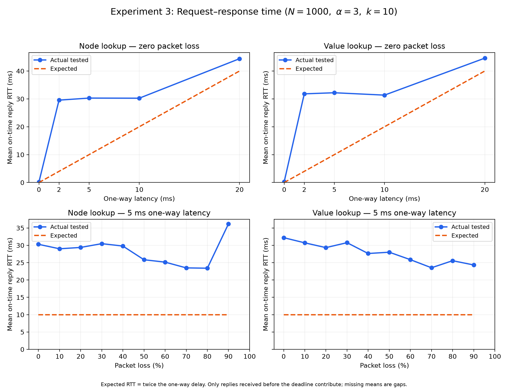
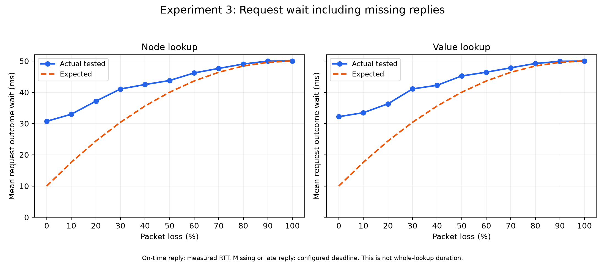

# Experiment 3: Request–response time versus packet loss and latency

## Setup and measurement

N=1000; alpha=3; k=10; seeds=1,2,3,4,5; 10 remote lookup trials per seed/type/condition; RPC timeout=50ms. Latency means one-way delay, applied independently to the request and reply paths.

The latency sweep holds packet loss at zero. The loss sweep holds the configured one-way latency fixed. Fresh seeded random IP:port networks and random values match Experiment 2, with verified healthy publishing and remote-only value sources. Each configuration is repeated across seeds. Publishing is outside the impairment window. The real algorithm is exercised, with no added retries, churn or changes to lookup decisions. Reusing matching checkpoints can share the common control point between sweeps.

At the outgoing request transport boundary, a monotonic timestamp is recorded; the reply is matched by its echoed RPC ID and timestamped at the receiving transport boundary. RTT is their difference and includes both simulated directions, processing, queueing and scheduling. After an early value return, observation continues until each launched request replies or reaches its own deadline. This observation window is excluded from lookup_elapsed_ms. Missing replies have a blank response_ms, never zero. Late replies are recorded separately and excluded from on-time RTT averages. Asynchronous timers model each one-way delay without blocking the lookup's parallel dispatch.

Means and unbiased sample variances are reported for on-time RTT, response fraction, capped request outcome wait and overall lookup duration. The outcome wait is RTT for an on-time reply, otherwise the configured deadline; it is a timeout-inclusive observation metric, not the duration of a successful reply or an actual early-returning value lookup. Seed-level response-rate variance and cluster-jackknife RTT standard errors account for trials on shared topologies.

## Expectations

With one-way delay L, received RTT should be approximately 2L plus implementation overhead. Without retries, independent packet loss alone does not add propagation delay to a reply that arrives; it lowers the received-response fraction. One exchange survives with q=(1-p)^2. For 2L below timeout T, the ideal capped outcome-wait mean is q·2L+(1-q)·T. If 2L exceeds the deadline, the timely response reference is zero and the ideal outcome wait is T. Empty RTT means are undefined when no on-time replies exist. These are transport-model references, not precise predictions for scheduler jitter or end-to-end lookup duration.

## Observed results

| sweep | loss | one-way ms | type | requests | on-time replies | response fraction | RTT mean ms | RTT variance | expected RTT ms | outcome wait ms | expected wait ms | lookup mean ms |
|---|---:|---:|---|---:|---:|---:|---:|---:|---:|---:|---:|---:|
| latency | 0.00 | 0.0 | node | 596 | 596 | 1.0000 | 0.1845 | 0.5112 | 0.0000 | 0.1845 | 0.0000 | 2.9425 |
| latency | 0.00 | 0.0 | value | 204 | 204 | 1.0000 | 0.2809 | 1.5440 | 0.0000 | 0.2809 | 0.0000 | 3.3735 |
| latency | 0.00 | 2.0 | node | 599 | 597 | 0.9967 | 29.5483 | 93.9191 | 4.0000 | 29.6166 | 4.0000 | 135.5864 |
| latency | 0.00 | 2.0 | value | 204 | 204 | 1.0000 | 31.8058 | 84.0722 | 4.0000 | 31.8058 | 4.0000 | 45.4287 |
| latency | 0.00 | 5.0 | node | 596 | 583 | 0.9782 | 30.2900 | 58.1857 | 10.0000 | 30.7199 | 10.0000 | 139.8271 |
| latency | 0.00 | 5.0 | value | 204 | 204 | 1.0000 | 32.2006 | 74.2557 | 10.0000 | 32.2006 | 10.0000 | 45.7829 |
| latency | 0.00 | 10.0 | node | 596 | 594 | 0.9966 | 30.2432 | 32.5311 | 20.0000 | 30.3095 | 20.0000 | 137.2149 |
| latency | 0.00 | 10.0 | value | 204 | 204 | 1.0000 | 31.3471 | 41.4944 | 20.0000 | 31.3471 | 20.0000 | 43.6456 |
| latency | 0.00 | 20.0 | node | 604 | 509 | 0.8427 | 44.4172 | 4.0005 | 40.0000 | 45.2953 | 40.0000 | 210.2778 |
| latency | 0.00 | 20.0 | value | 259 | 214 | 0.8263 | 44.6143 | 4.5936 | 40.0000 | 45.5501 | 40.0000 | 80.8944 |
| loss | 0.00 | 5.0 | node | 596 | 583 | 0.9782 | 30.2900 | 58.1857 | 10.0000 | 30.7199 | 10.0000 | 139.8271 |
| loss | 0.00 | 5.0 | value | 204 | 204 | 1.0000 | 32.2006 | 74.2557 | 10.0000 | 32.2006 | 10.0000 | 45.7829 |
| loss | 0.10 | 5.0 | node | 602 | 488 | 0.8106 | 28.9973 | 61.4152 | 10.0000 | 32.9745 | 17.6000 | 178.7675 |
| loss | 0.10 | 5.0 | value | 210 | 180 | 0.8571 | 30.7112 | 69.1923 | 10.0000 | 33.4668 | 17.6000 | 46.9502 |
| loss | 0.20 | 5.0 | node | 605 | 377 | 0.6231 | 29.3859 | 53.7645 | 10.0000 | 37.1545 | 24.4000 | 210.8773 |
| loss | 0.20 | 5.0 | value | 240 | 159 | 0.6625 | 29.3335 | 52.2638 | 10.0000 | 36.3084 | 24.4000 | 61.0735 |
| loss | 0.30 | 5.0 | node | 639 | 293 | 0.4585 | 30.4775 | 65.8790 | 10.0000 | 41.0483 | 30.4000 | 239.2627 |
| loss | 0.30 | 5.0 | value | 276 | 128 | 0.4638 | 30.7563 | 60.9376 | 10.0000 | 41.0754 | 30.4000 | 76.6370 |
| loss | 0.40 | 5.0 | node | 650 | 242 | 0.3723 | 29.7813 | 49.7747 | 10.0000 | 42.4724 | 35.6000 | 243.7654 |
| loss | 0.40 | 5.0 | value | 340 | 118 | 0.3471 | 27.6352 | 65.1024 | 10.0000 | 42.2381 | 35.6000 | 97.0298 |
| loss | 0.50 | 5.0 | node | 693 | 179 | 0.2583 | 25.8356 | 54.2698 | 10.0000 | 43.7584 | 40.0000 | 258.0885 |
| loss | 0.50 | 5.0 | value | 446 | 97 | 0.2175 | 28.0102 | 73.3072 | 10.0000 | 45.2175 | 40.0000 | 141.4472 |
| loss | 0.60 | 5.0 | node | 724 | 111 | 0.1533 | 25.1490 | 53.5642 | 10.0000 | 46.1900 | 43.6000 | 272.4058 |
| loss | 0.60 | 5.0 | value | 472 | 70 | 0.1483 | 25.8589 | 66.6541 | 10.0000 | 46.4198 | 43.6000 | 156.2321 |
| loss | 0.70 | 5.0 | node | 682 | 61 | 0.0894 | 23.4888 | 44.0778 | 10.0000 | 47.6288 | 46.4000 | 261.0497 |
| loss | 0.70 | 5.0 | value | 586 | 48 | 0.0819 | 23.5232 | 33.4281 | 10.0000 | 47.8312 | 46.4000 | 211.3597 |
| loss | 0.80 | 5.0 | node | 581 | 21 | 0.0361 | 23.3954 | 11.1783 | 10.0000 | 49.0384 | 48.4000 | 231.2006 |
| loss | 0.80 | 5.0 | value | 559 | 18 | 0.0322 | 25.5643 | 48.4548 | 10.0000 | 49.2132 | 48.4000 | 219.6065 |
| loss | 0.90 | 5.0 | node | 502 | 1 | 0.0020 | 36.1813 | 0.0000 | 10.0000 | 49.9725 | 49.6000 | 207.7513 |
| loss | 0.90 | 5.0 | value | 513 | 2 | 0.0039 | 24.3274 | 27.9999 | 10.0000 | 49.8999 | 49.6000 | 211.1729 |
| loss | 1.00 | 5.0 | node | 500 | 0 | 0.0000 |  |  |  | 50.0000 | 50.0000 | 205.5300 |
| loss | 1.00 | 5.0 | value | 500 | 0 | 0.0000 |  |  |  | 50.0000 | 50.0000 | 205.2662 |

## Comparison and deviations

- latency, node: loss=0.0000, one-way delay=0.0000 ms; measured on-time RTT=0.1845 ms versus 0.0000 ms reference; response fraction=1.0000 versus 1.0000.
- latency, value: loss=0.0000, one-way delay=0.0000 ms; measured on-time RTT=0.2809 ms versus 0.0000 ms reference; response fraction=1.0000 versus 1.0000.
- latency, node: loss=0.0000, one-way delay=2.0000 ms; measured on-time RTT=29.5483 ms versus 4.0000 ms reference; response fraction=0.9967 versus 1.0000.
- latency, value: loss=0.0000, one-way delay=2.0000 ms; measured on-time RTT=31.8058 ms versus 4.0000 ms reference; response fraction=1.0000 versus 1.0000.
- latency, node: loss=0.0000, one-way delay=5.0000 ms; measured on-time RTT=30.2900 ms versus 10.0000 ms reference; response fraction=0.9782 versus 1.0000.
- latency, value: loss=0.0000, one-way delay=5.0000 ms; measured on-time RTT=32.2006 ms versus 10.0000 ms reference; response fraction=1.0000 versus 1.0000.
- latency, node: loss=0.0000, one-way delay=10.0000 ms; measured on-time RTT=30.2432 ms versus 20.0000 ms reference; response fraction=0.9966 versus 1.0000.
- latency, value: loss=0.0000, one-way delay=10.0000 ms; measured on-time RTT=31.3471 ms versus 20.0000 ms reference; response fraction=1.0000 versus 1.0000.
- latency, node: loss=0.0000, one-way delay=20.0000 ms; measured on-time RTT=44.4172 ms versus 40.0000 ms reference; response fraction=0.8427 versus 1.0000.
- latency, value: loss=0.0000, one-way delay=20.0000 ms; measured on-time RTT=44.6143 ms versus 40.0000 ms reference; response fraction=0.8263 versus 1.0000.
- loss, node: loss=0.5000, one-way delay=5.0000 ms; measured on-time RTT=25.8356 ms versus 10.0000 ms reference; response fraction=0.2583 versus 0.2500.
- loss, value: loss=0.5000, one-way delay=5.0000 ms; measured on-time RTT=28.0102 ms versus 10.0000 ms reference; response fraction=0.2175 versus 0.2500.
- loss, node: loss=1.0000, one-way delay=5.0000 ms; measured on-time RTT=undefined (no timely replies) versus undefined reference; response fraction=0.0000 versus 0.0000.
- loss, value: loss=1.0000, one-way delay=5.0000 ms; measured on-time RTT=undefined (no timely replies) versus undefined reference; response fraction=0.0000 versus 0.0000.

RTT above 2L is expected from processing, timer precision and goroutine scheduling. Received-only RTT should remain broadly flat across packet loss at fixed delay, while missing replies and the timeout-inclusive wait increase. Lookup duration can grow more sharply because node lookup waits for whole batches and multiple rounds; values may terminate early. Deviations in response fraction can reflect finite sampling, delay near the deadline or scheduling. Inspect requests.csv for drop and late-response flags instead of substituting a zero time for absent replies.

## Timer calibration

The same time.AfterFunc primitive was measured independently without networking, using 25 serial samples per delay. This diagnoses host timer/scheduler overhead; it does not replace the ideal 2L reference with a fitted curve. Serial calibration is a diagnostic, not a precise prediction of parallel lookup timing.

| requested delay ms | measured timer mean ms | variance | min ms | max ms |
|---:|---:|---:|---:|---:|
| 0.0000 | 0.0000 | 0.0000 | 0.0000 | 0.0000 |
| 2.0000 | 2.3536 | 0.0401 | 2.0442 | 2.5417 |
| 5.0000 | 5.3370 | 0.0398 | 5.0432 | 5.7880 |
| 10.0000 | 10.3370 | 0.0236 | 10.0490 | 10.5878 |
| 20.0000 | 20.2966 | 0.0233 | 20.0543 | 20.5591 |

Compare standalone calibration with the networked run before attributing deviations to timer resolution. If standalone delays track the requested values while networked RTTs plateau, serial timer overhead does not reproduce that gap; concurrent scheduling, queueing and host load need separate profiling. This diagnostic runs separately and does not establish a single cause. Close to the RPC deadline, scheduling overhead also creates late or missing observations even without injected packet loss. The CSV retains response fractions and late-response counts so the received-only mean cannot conceal those events.
